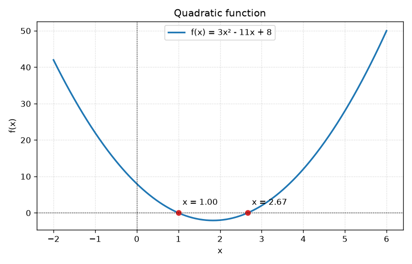
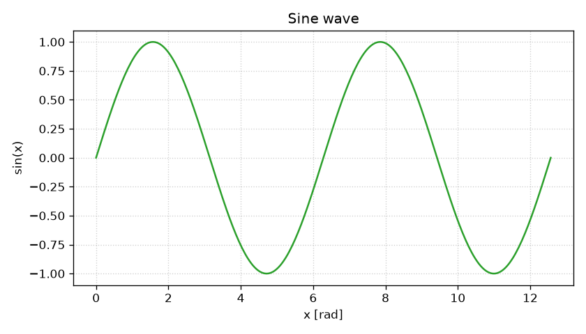
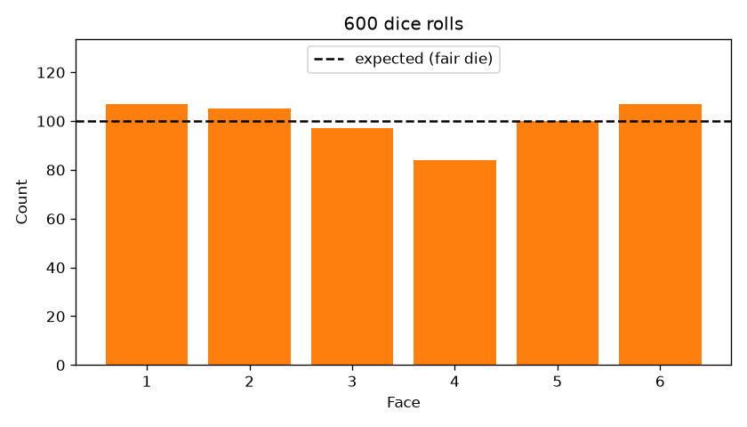

# matplotlib_basics

My first steps with matplotlib and numpy: three simple charts built from small,
tested functions.

| Quadratic function with roots | Sine wave | 600 dice rolls |
|---|---|---|
|  |  |  |

## Run

```bash
cd matplotlib_basics
pip install matplotlib numpy
python -m matplotlib_basics      # saves PNG files to output/
```

## What is inside

- `quadratic`, `quadratic_roots`, `format_quadratic` - plain math, tested with
  known results (two roots, one root, no real roots).
- `roll_dice` takes a `seed`, so the "random" rolls are the same every time.
  That makes them testable.
- Every `plot_*` function **returns** a matplotlib `Figure` instead of calling
  `plt.show()`. Thanks to that, tests can check the title, the labels and the
  plotted data, and the same figure can be saved to a file or shown on screen.

## Tests

```bash
cd matplotlib_basics
pytest
```

They run automatically on GitHub Actions on every push
(`.github/workflows/matplotlib_basics.yml`).
